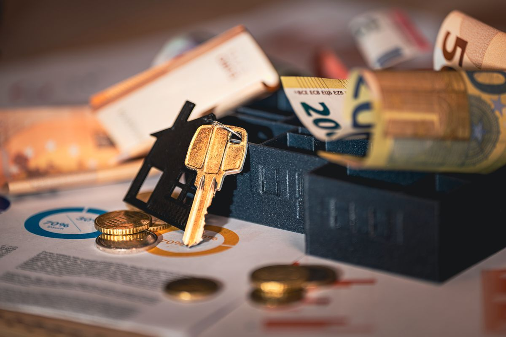
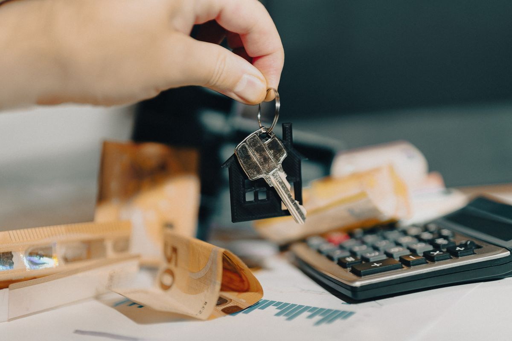
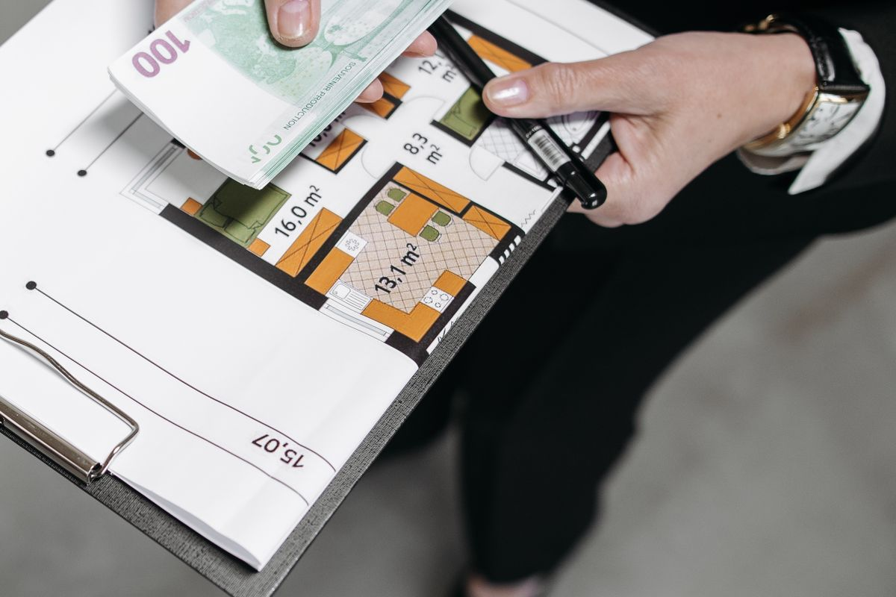
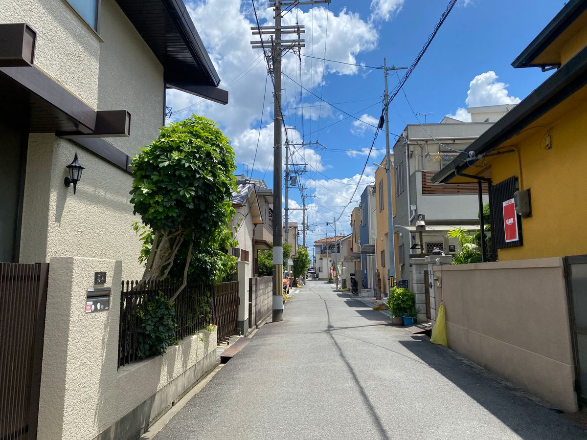
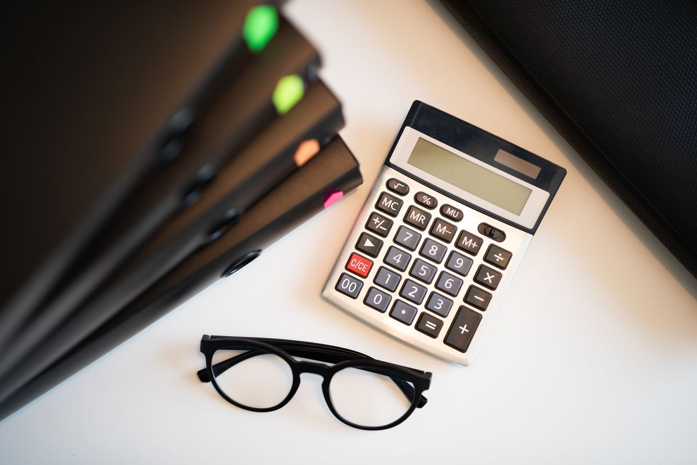

> <strong>TL;DR — 共有持分の買取相場まとめ</strong>
> 共有持分の買取相場は<strong>不動産全体の評価額×持分割合×60〜70%</strong>が目安。例:全体2,000万円の1/2持分なら600〜700万円程度。相場より高く売るには①複数業者の見積もり比較、②他の共有者への先打診、③全員合意で共同売却の3択がある。宅建業者（大阪府知事(1)第65646号）が整理しました。買取の依頼先の選び方と流れは[共有持分の買取・売却方法](/guide/kyouyuu-mochibun-kaitori/)にまとめています。

<strong>Q: 共有持分の買取相場はどのくらいですか？</strong>
A: <strong>不動産全体の評価額×持分割合×60〜70%</strong>が目安です（専門買取業者の場合）。例えば市場価格2,000万円の不動産の1/2持分なら600〜700万円程度。ただし物件の状態・地域・共有者数・接道条件によって変動します。

---

<strong>Q: なぜ共有持分は全体評価額より安くなるのですか？</strong>
A: 共有持分のみでは不動産を単独で売却・賃貸・建替えできないためです（民法第249条・251条）。買取業者が他の共有者との権利調整リスクを負う分、価格に反映されます。他の共有者に先に売却交渉すると、より高い価格が期待できます。

---

「自分の共有持分、売ったらいくらになるの？」——相続や離婚で共有名義になった不動産を手放したいとき、まず気になるのが売却価格です。でも、不動産業者に相談しても「状況による」「まず査定を」と言われるだけで、具体的な数字がなかなか見えてこないことがあります。

この記事では、<strong>共有持分の買取相場を計算する基本式・持分割合別の早見表・物件種別ごとの目安・買取価格が下がる要因と対処法</strong>を宅建業者の立場から具体的に解説します。

## 共有持分の買取相場：基本の計算式

共有持分の買取価格は、一般的に次の計算式で算出されます。

<strong>共有持分の買取相場 ＝ 不動産全体の市場価格 × 持分割合 × 0.60〜0.70</strong>

この「0.60〜0.70（60〜70%）」が共有持分特有の割引率です。なぜ割り引かれるのかについては後述しますが、まずは具体的な計算例を確認してください。

### 計算例：市場価格2,000万円の不動産の場合

| 持分割合 | 持分の理論価値 | 買取相場（60%） | 買取相場（70%） |
|---------|------------|--------------|--------------|
| 1/2 | 1,000万円 | <strong>600万円</strong> | <strong>700万円</strong> |
| 1/3 | 667万円 | 400万円 | 467万円 |
| 1/4 | 500万円 | 300万円 | 350万円 |
| 2/3 | 1,333万円 | 800万円 | 933万円 |
| 1/6 | 333万円 | 200万円 | 233万円 |

上表の「持分の理論価値」は不動産全体の市場価格に持分割合をかけた数字です。買取業者はここからさらに割引いた価格（買取相場）で買い取ります。

なお「不動産全体の市場価格」は、<strong>固定資産税評価額ではなく、仲介で売り出したときに想定される売却価格（実勢価格）</strong>を使います。固定資産税評価額は実勢価格の70%程度が目安とされているため、使い分けに注意してください。

この「不動産全体の市場価格」をご自身で出す手順は、このページの後半「路線価から自分で計算する4ステップ」にまとめています。相続税路線価を0.8で割り戻す方法と、大阪市24区の路線価目安一覧、掛け目が0.3〜0.5まで下がる条件を実額で解説しています。

## なぜ共有持分は「全体×持分割合」より安くなるのか

買取業者が共有持分を割引価格で買い取るのには、明確な理由があります。

<strong>理由① 単独で使用・売却できない</strong>

民法第249条では「各共有者は、共有物の全部について、その持分に応じた使用をすることができる」と定められています。しかし民法第251条により、<strong>不動産全体の売却・大規模な改修には共有者全員の同意が必要</strong>です。持分を取得しても、他の共有者が反対すれば自由に売れません。

<strong>理由② 権利整理のコストがかかる</strong>

買取業者が共有持分を取得した後、他の共有者と交渉して全体を売却するか、共有物分割請求訴訟（民法第258条）を起こして法的に解決するか——どちらにしても時間・費用・手間がかかります。このコストが買取価格に反映されます。

<strong>理由③ 流動性リスク</strong>

持分だけでは次の買い手も見つけにくいため、買取業者は「在庫として抱えるリスク」分も見込んで価格を低く設定します。

## 物件種別ごとの共有持分買取相場

物件の種別によっても相場の目安が変わります。以下は一般的な傾向です。

### 一戸建て（住宅）

相場割引率の目安: <strong>60〜70%</strong>

相続で最も多い物件タイプです。空き家になっているケースが多く、老朽化・固定資産税の負担が持ち続けるコストになります。老朽化が進んでいる場合は割引率が大きくなる傾向があります。

### マンション（区分所有建物）

相場割引率の目安: <strong>65〜75%</strong>

管理費・修繕積立金の滞納がないか確認が必要です。滞納ありの場合は割引率が下がることがあります。一方、立地条件が良いマンションは流動性が高く、割引率が小さくなるケースもあります。

### 土地（更地・駐車場含む）

相場割引率の目安: <strong>55〜65%</strong>

建物がなく権利関係がシンプルな分、買取業者は動きやすいため、やや買取価格が高くなる傾向があります。ただし地方の需要が少ないエリアでは流動性が低く、割引率が大きくなる場合があります。

### アパート・一棟賃貸物件

相場割引率の目安: <strong>60〜70%</strong>

賃貸収入がある分、収益還元で価値を算出できるため、一般的な割引率の範囲に収まります。ただし入居率が低い・修繕が必要・サブリース契約中などの場合は価格が下がります。

### 借地権付き建物

相場割引率の目安: <strong>50〜65%</strong>

地主の承諾が必要なケースがあり、売却の障壁が高いため割引率が大きくなりがちです。ただし地主との関係が良好であれば価格交渉の余地があります。

## 地域別の価格差

買取相場の<strong>割引率（60〜70%）は地域によって大きく変わりませんが</strong>、不動産全体の価格（分母）が地域によって異なるため、買取額の絶対値は大きく変わります。

| エリア | 一戸建て（木造・30坪・駅5分）の目安価格 | 1/2持分の買取相場（65%換算） |
|-------|-------------------------------|-------------------------|
| 東京23区（人気エリア） | 5,000〜8,000万円 | 1,625〜2,600万円 |
| 大阪市内（中心部） | 2,000〜4,000万円 | 650〜1,300万円 |
| 名古屋市内 | 1,500〜3,000万円 | 488〜975万円 |
| 地方都市（人口20万人以上） | 500〜1,500万円 | 163〜488万円 |
| 地方（過疎エリア） | 0〜500万円 | 買取困難なケースも |

地方・過疎エリアの不動産は需要が少なく、専門買取業者でも「買取価格ゼロ」もしくは「引き取り」になるケースがあります。このような場合は相続土地国庫帰属制度（負担金約20万円）や自治体への寄付も選択肢になります。

## 買取価格が下がる5つの要因

同じ物件でも、以下の要因があると基本相場（60〜70%）よりさらに割引かれます。

### 要因① 接道不良・再建築不可

公道に接していない土地、接道幅が2m未満の土地は<strong>再建築不可物件</strong>になります（建築基準法第43条）。建て替えができないため需要が限られ、買取価格が大幅に下がります。追加割引の目安は<strong>さらに10〜30%程度</strong>です。

### 要因② 老朽化・修繕が必要な状態

雨漏り・シロアリ被害・外壁の著しい劣化など修繕費が必要な状態だと、修繕コストが買取価格から差し引かれます。追加割引の目安は修繕費見積もりに応じて変動します。

### 要因③ 共有者数が多い

共有者が2人より3人・4人と増えるほど、権利整理のコスト（交渉相手が増える）が上がり、買取価格が下がる傾向があります。特に行方不明の共有者がいる場合は大幅な割引になることがあります。

### 要因④ 相続登記が未了・書類不備

2024年4月から相続登記が義務化されました（不動産登記法第76条の2）。相続登記が済んでいない状態でも買取自体は可能ですが、決済前に登記が必要なため、司法書士費用がかかる分を勘案して価格が調整されることがあります。

### 要因⑤ 土地・建物に問題がある（アスベスト・土壌汚染等）

1975年以前に建てられた建物はアスベスト（石綿）が使われている可能性があります。解体時の飛散防止費用が通常より高くなるため、買取価格が下がることがあります。

## 相場より高く売る3つの方法

買取業者の提示価格（60〜70%）を最大限引き上げるためにできることをまとめます。

### 方法① 複数の買取業者から見積もりを取って比較する

共有持分の買取相場は業者によって異なります。1社だけに相談すると価格の妥当性が判断できないため、<strong>最低でも2〜3社に相談して比較する</strong>ことが重要です。見積もりを取ることは無料で、業者に申し込む義務もありません。

### 方法② 他の共有者に先に買取を打診する

他の共有者（兄弟・親族）に「自分の持分を買い取ってほしい」と持ちかける方法です。他の共有者が持分を追加取得すると自分の権利が強化されるため、<strong>全体評価額×持分割合に近い価格</strong>での合意が期待できます。

ただし他の共有者が資金を持っていない・感情的なトラブルがある場合は成立しにくいです。

### 方法③ 共有者全員で共同売却に合意する

全員が合意して不動産全体を市場売却すれば、仲介を通じて市場価格での売却ができます。仲介手数料（売却価格×3%＋6万円＋税）はかかりますが、割引率分（30〜40%）の差額を取り戻せます。

共有者間の関係が良好であれば、この方法が最も手取り額を最大化できます。

## 仲介売却と買取の価格差：実例比較

| | 全員合意の仲介売却 | 持分のみ買取 |
|--|:---------------:|:---------:|
| 売却価格の基準 | 市場価格（100%） | 市場×持分×60〜70% |
| 全員の同意 | <strong>必要</strong> | 不要 |
| 売却完了までの期間 | 3〜12ヶ月 | <strong>2〜4週間</strong> |
| 仲介手数料 | 売却価格の3%＋6万円＋税 | <strong>なし</strong> |
| 手間 | 大（共有者全員の調整が必要） | <strong>小</strong> |
| こんな場合に向く | 全員が協力的・急がない | もめている・早く解決したい |

実例で比較すると次のとおりです。

<strong>[実例] 市場価格3,000万円・1/2持分の場合</strong>

- 全員合意の仲介売却: 3,000万円×1/2 = 1,500万円（仲介手数料約105万円差し引き後 ≒ 1,395万円）
- 持分のみ買取（65%換算）: 3,000万円×1/2×0.65 = <strong>975万円</strong>（手数料なし）

差額は約420万円です。ただし買取の場合は<strong>2週間以内に現金化できる・共有者の同意不要・手間ゼロ</strong>というメリットがあります。「固定資産税を払い続けるより早く手放したい」「共有者と関わりたくない」という状況では、この差額を払う価値があるかどうかで判断します。

## 路線価から自分で計算する4ステップ

「業者に聞く前に、だいたいの金額を自分で知っておきたい」という方のために、ここからは大阪市の物件を例に、ご自身で金額を出す手順を順に説明します。金額の当たりがついていれば、提示された数字が妥当かどうかをご自身で判断できます。

<strong>共有持分の買取額は「土地建物の時価 × 持分割合 × 買取掛け目」の3つの掛け算で概算できます。</strong>

<strong>土地の時価は、国税庁の相続税路線価を0.8で割り戻すと目安が出ます。路線価は地価公示価格等を基にした価格の80％程度を目途に定められているためです。</strong>

<strong>買取掛け目は、共有者と連絡がつき物件が空いていれば0.5〜0.7。連絡不通・共有者の居住中・持分4分の1未満といった事情が付くと0.3〜0.5まで下がります。</strong>

上の相場計算で使った60〜70%は一般的な目安で、ここから先の掛け目は、当社が金額を組み立てるときの条件別の目安です。

### 共有持分の値段は3つの掛け算で決まります

<strong>買取額の目安 ＝ 土地建物の時価 × 持分割合 × 買取掛け目</strong>

3つの数字のうち、<strong>ご自身で調べられるのは前の2つです。</strong>土地の時価は路線価から逆算でき、持分割合は登記事項証明書に書かれています。難しいのは3つ目の掛け目だけです。

なぜ掛け目が1にならないのか。理由は、共有という権利の性質にあります。

- <strong>共有物に変更を加えるには、他の共有者全員の同意が必要です</strong>（民法251条1項）。建て替えも大規模なリフォームも、単独ではできません
- <strong>管理に関する事項は、持分の価格に従って過半数で決めます</strong>（民法252条1項）。持分が4分の1なら、決定に加われないことになります
- <strong>各共有者は、いつでも共有物の分割を請求できます</strong>（民法256条1項）。協議が調わないときは、裁判所に分割を請求することになります（民法258条1項）

つまり<strong>持分を買った側は、買った瞬間に「使えない不動産」を抱えることになります。</strong>そこから使える状態に持っていくための時間と費用が、掛け目という形で価格から引かれています。

同意が要るのは上に挙げた変更・管理の場面です。この点の詳しい整理は[共有持分とは｜定義・持分割合の意味・処分方法4つの比較表](/guide/kyoyuu-mochibun-teigi-hikaku/)にまとめています。

### ステップ1：相続税路線価を0.8で割って、土地の時価を出します

最初に土地の時価を出します。使うのは国税庁の相続税路線価です。

<strong>路線価の調べ方</strong>

国税庁の[財産評価基準書 路線価図・評価倍率表](https://www.rosenka.nta.go.jp/)で、年分 → 大阪府 → 路線価図 → 市区町村 → 町名の順に進むと、地図が表示されます。物件が面している道路に書かれた数字が路線価です。

<strong>数字は千円単位です。</strong>右隣のアルファベットは借地権割合を示す記号です。記号ごとの割合は、国税庁の路線価図の説明で確認できます。

令和8年分の路線価は<strong>2026年7月1日に公開</strong>されており、評価時点は令和8年1月1日です。

<strong>0.8で割り戻す理由</strong>

路線価は、そのままでは売買される価格より低い数字です。国税庁は路線価等について、次のように公表しています。

> 路線価等は、１月１日を評価時点として、１年間の地価変動などを考慮し、地価公示価格等を基にした価格の８０％程度を目途に定めています。
> （国税庁「令和８年分の路線価等について」）

したがって、<strong>路線価 ÷ 0.8</strong> で公示価格の水準に近い時価の目安に戻せます。

| 調べた路線価 | 時価の目安（÷0.8） | 土地50平方メートルの場合 |
|---|---|---|
| 8万円/平方メートル | 10万円/平方メートル | 500万円 |
| 12万円/平方メートル | 15万円/平方メートル | 750万円 |
| 20万円/平方メートル | 25万円/平方メートル | 1,250万円 |
| 40万円/平方メートル | 50万円/平方メートル | 2,500万円 |

地積（土地の面積）は登記事項証明書か、毎年4月に届く固定資産税の課税明細書で確認できます。

<strong>大阪市の地価は5年連続で上がっています</strong>

参考までに、直近の地価の動きです。令和8年地価公示では、<strong>大阪圏の住宅地が前年比プラス2.5％、商業地がプラス7.3％</strong>で、いずれも5年連続の上昇となりました（国土交通省「令和8年地価公示の概要」）。

大阪市の最高路線価は<strong>北区角田町の御堂筋で1平方メートル当たり2,120万円</strong>、前年比プラス1.5％です（国税庁「令和8年分都道府県庁所在都市の最高路線価」）。

<strong>数年前に聞いた金額のまま計算すると、低く出ます。</strong>路線価は毎年7月に更新されるため、最新の年分でご確認ください。

### 大阪市24区の路線価目安一覧（住宅地）

区ごとの水準感をつかむための一覧です。<strong>あくまで区全体のレンジであり、実際は道路一本ごとに違います。</strong>ご自身の物件については、必ず前章の手順で路線価図をご確認ください。

| 区 | 住宅地の路線価目安（1平方メートル） | 時価目安（÷0.8） | 土地50平方メートルの時価目安 |
|---|---|---|---|
| 北区 | 45〜80万円 | 約56〜100万円 | 約2,812〜5,000万円 |
| 中央区 | 30〜60万円 | 約38〜75万円 | 約1,875〜3,750万円 |
| 福島区 | 25〜45万円 | 約31〜56万円 | 約1,562〜2,812万円 |
| 西区 | 20〜40万円 | 約25〜50万円 | 約1,250〜2,500万円 |
| 天王寺区 | 20〜35万円 | 約25〜44万円 | 約1,250〜2,188万円 |
| 阿倍野区 | 18〜30万円 | 約22〜38万円 | 約1,125〜1,875万円 |
| 浪速区 | 18〜35万円 | 約22〜44万円 | 約1,125〜2,188万円 |
| 淀川区 | 15〜28万円 | 約19〜35万円 | 約938〜1,750万円 |
| 城東区 | 14〜24万円 | 約18〜30万円 | 約875〜1,500万円 |
| 東成区 | 14〜25万円 | 約18〜31万円 | 約875〜1,562万円 |
| 都島区 | 13〜22万円 | 約16〜28万円 | 約812〜1,375万円 |
| 住吉区 | 13〜22万円 | 約16〜28万円 | 約812〜1,375万円 |
| 旭区 | 12〜20万円 | 約15〜25万円 | 約750〜1,250万円 |
| 東淀川区 | 12〜20万円 | 約15〜25万円 | 約750〜1,250万円 |
| 鶴見区 | 12〜20万円 | 約15〜25万円 | 約750〜1,250万円 |
| 港区 | 12〜20万円 | 約15〜25万円 | 約750〜1,250万円 |
| 東住吉区 | 11〜19万円 | 約14〜24万円 | 約688〜1,188万円 |
| 平野区 | 10〜18万円 | 約12〜22万円 | 約625〜1,125万円 |
| 住之江区 | 10〜18万円 | 約12〜22万円 | 約625〜1,125万円 |
| 此花区 | 9〜16万円 | 約11〜20万円 | 約562〜1,000万円 |
| 大正区 | 9〜16万円 | 約11〜20万円 | 約562〜1,000万円 |
| 西淀川区 | 9〜16万円 | 約11〜20万円 | 約562〜1,000万円 |
| 生野区 | 8〜18万円 | 約10〜22万円 | 約500〜1,125万円 |
| 西成区 | 7〜15万円 | 約9〜19万円 | 約438〜938万円 |

<small>路線価の目安は、国税庁「財産評価基準書（路線価図・評価倍率表）」および国土交通省「地価公示」をもとに、当社が区ごとの住宅地の水準として整理した参考値です。時価目安は路線価を0.8で割り戻した計算値です。</small>

<strong>同じ「4分の1の持分」でも、北区と西成区では買取額が5倍以上変わります。</strong>区別のより細かいデータは[大阪市24区の訳あり物件買取相場マップ](/guide/osaka-24ku-wakeari-kakakutai-map/)にまとめています。

### ステップ2：建物の価値と解体費を差し引きます

土地の時価が出たら、次は建物です。ここを飛ばすと、計算額が実際より高く出ます。

<strong>木造で築30年を超えている場合、建物の価値はゼロとして計算してください。</strong>そのうえで、将来かかる解体費を全体の価値から差し引きます。買い受ける側は、いずれ壊す前提で金額を組み立てるためです。

大阪市の木造住宅の解体費の目安は次のとおりです。

| 条件 | 坪単価の目安 | 延床30坪の総額目安 |
|---|---|---|
| 前面道路4メートル以上・重機が入る | 4〜6万円 | 120〜180万円 |
| 前面道路4メートル未満 | 6〜8万円 | 180〜240万円 |
| 重機が入らず手壊しになる | 8〜12万円 | 240〜360万円 |

このほかに、アスベスト事前調査・残置物処分・ブロック塀撤去などで30〜50万円の上乗せが発生します。詳しくは[大阪市の解体費用の相場【2026年】](/guide/osaka-kaitai-hiyou-soba-2026/)をご覧ください。

<strong>建物が現役で使える状態（築浅・賃貸中で入居者がいる等）なら、この差し引きは不要です。</strong>その場合は建物の価値を土地に足して計算します。

### ステップ3：持分割合を掛けます

登記事項証明書の権利部（甲区）に、「持分3分の1」のようにご自身の割合が記載されています。手元に無い場合は、法務局で誰でも取得できます。

ステップ2までで出した金額に、この割合を掛けます。<strong>ここで出る金額が「持分に対応する理論上の取り分」です。</strong>

覚えておいていただきたいのは、<strong>この金額がそのまま手に入るのは、共有者どうしで売買する場合か、共有者全員が合意して物件をまるごと売る場合だけ</strong>だということです。業者に持分だけを売る場合は、次のステップの掛け目が入ります。

### ステップ4：買取掛け目を掛けます。0.3〜0.5に沈む4つの条件

最後が掛け目です。当社が金額を組み立てるときの目安を、条件別に開示します。

| 物件と共有者の状況 | 掛け目の目安 |
|---|---|
| 共有者全員と連絡がつく／物件は空き家／持分2分の1以上 | 0.5〜0.7 |
| 共有者の一部と連絡が取れない（所在等不明） | 0.3〜0.45 |
| 共有者が無償で住んでいる（使用貸借の状態） | 0.3〜0.45 |
| 第三者に賃貸中だが、賃料が分配されていない | 0.35〜0.5 |
| 持分が4分の1未満 | 0.3〜0.4 |
| 建物が再建築不可・接道が2メートル未満 | 上記にさらに0.7〜0.85を掛ける |

<small>当社が買取価格を検討する際の判断の目安です。業界共通の基準ではありません。実際の金額は物件ごとに変わります。</small>

条件が重なると掛け目は下限に寄ります。理由を1つずつお伝えします。

<strong>共有者と連絡が取れない場合</strong>

改正民法により、<strong>裁判所に請求して所在等不明共有者の持分を取得する制度</strong>（民法262条の2）と、<strong>所在等不明共有者の持分を第三者に譲渡する権限を付与してもらう制度</strong>（民法262条の3）ができました。以前より道筋は整いましたが、いずれも<strong>裁判所の手続きであり、時間と費用がかかります。</strong>

さらに、<strong>所在等不明共有者の持分が相続財産に属し、共同相続人間で遺産分割をすべき場合には、相続開始から10年を経過していないとこの裁判はできません</strong>（民法262条の2第3項）。相続してすぐの物件では、この手が使えないことがあります。

この分の負担が掛け目に反映されます。詳しくは[共有者が行方不明・連絡不能の場合に不動産を売る3つの方法](/guide/kyouyuu-fuzai-baikyaku/)で扱っています。

<strong>共有者が無償で住んでいる場合</strong>

各共有者は、共有物の全部について持分に応じた使用ができます（民法249条1項）。<strong>持分を買っても、住んでいる方に直ちに出ていってもらえるわけではありません。</strong>

一方で、共有物を使用する共有者は、別段の合意がある場合を除き、他の共有者に対して<strong>自己の持分を超える使用の対価を償還する義務を負います</strong>（民法249条2項）。話し合いの材料にはなりますが、実際に回収するには交渉か法的手続きが要ります。この不確実さが価格に出ます。

<strong>持分が4分の1未満の場合</strong>

管理に関する事項は持分の価格に従って過半数で決めます（民法252条1項）。<strong>持分が小さいほど、買った後にできることが少なくなります。</strong>結果として、共有物分割請求で決着をつける前提の金額になります。

分割請求そのものの流れは[共有持分を売った後どうなる？共有物分割請求の流れ・期間・費用](/guide/kyouyuu-butsu-bunkatsu-seikyu-jitsumu/)にまとめています。

### 実際に計算した3ケース

ここまでの4ステップを、大阪市内の典型的な3パターンで最後まで計算します。物件の条件は、よくある形に合わせた設例です。

<strong>ケース1：生野区・築45年の木造長屋・持分3分の1・空き家</strong>

条件は、土地45平方メートル、路線価12万円/平方メートル、兄弟3人の共有で全員と連絡がつき、建物は空き家。前面道路が狭く手壊し解体になる想定です。

| 手順 | 計算 | 金額 |
|---|---|---|
| ステップ1：土地の時価 | 12万円 ÷ 0.8 × 45平方メートル | 675万円 |
| ステップ2：解体費を差し引く | 675万円 − 150万円 | 525万円 |
| ステップ3：持分を掛ける | 525万円 × 1/3 | 175万円 |
| ステップ4：掛け目0.45〜0.55 | 175万円 × 0.45〜0.55 | <strong>約80〜95万円</strong> |

解体費150万円は、延床15坪×手壊し8万円/坪に残置物処分を加えた見込みです。

<strong>このケースは掛け目が高めに出ます。</strong>共有者全員と連絡がつき、空き家であるためです。実際には、兄弟3人で話し合って物件をまるごと売却できれば、持分相当額の175万円に近い金額を狙えます。<strong>まず共有者に相談する価値があるのは、こういうケースです。</strong>

<strong>ケース2：東淀川区・築30年の分譲マンション1室・持分2分の1・兄が居住中</strong>

条件は、近隣の成約事例から見た部屋の時価が1,400万円、亡くなった親から兄と2分の1ずつ相続し、兄が家賃を払わずに住んでいる状態です。

| 手順 | 計算 | 金額 |
|---|---|---|
| ステップ1・2：物件の時価 | 建物が使える状態のため差し引きなし | 1,400万円 |
| ステップ3：持分を掛ける | 1,400万円 × 1/2 | 700万円 |
| ステップ4：掛け目0.3〜0.45 | 700万円 × 0.3〜0.45 | <strong>約210〜315万円</strong> |

持分は2分の1と大きいのに、掛け目は下限に寄ります。<strong>共有者が住んでいるという一点で、買った側がすぐに使えないからです。</strong>

このケースでは、<strong>兄に持分を買い取ってもらう交渉が最初の選択肢</strong>になります。合意できれば700万円に近い金額が視野に入り、業者買取との差は400万円以上です。話がまとまらない場合の手段として、業者買取があります。

<strong>ケース3：平野区・築38年の木造戸建・持分4分の1・共有者1人が所在不明</strong>

条件は、土地80平方メートル、路線価14万円/平方メートル、相続人4人の共有で、そのうち1人と連絡が取れない状態です。

| 手順 | 計算 | 金額 |
|---|---|---|
| ステップ1：土地の時価 | 14万円 ÷ 0.8 × 80平方メートル | 1,400万円 |
| ステップ2：解体費を差し引く | 1,400万円 − 200万円 | 1,200万円 |
| ステップ3：持分を掛ける | 1,200万円 × 1/4 | 300万円 |
| ステップ4：掛け目0.3〜0.4 | 300万円 × 0.3〜0.4 | <strong>約90〜120万円</strong> |

所在不明の共有者がいることと、持分が4分の1であることが重なり、掛け目は最も低い水準になります。<strong>土地全体の時価は1,400万円あるのに、持分の着地は約90〜120万円です。</strong>

この差を見て「安すぎる」と感じられるのは自然なことです。差の正体は、<strong>裁判所の手続きを経て権利をまとめるまでにかかる時間と費用</strong>です。ご自身で共有者全員をまとめられるなら、業者に売るより手取りは増えます。まとめられないときの選択肢が、持分だけの売却です。

### 計算額と実際の査定額がずれる5つの要因

この4ステップは、<strong>話を始めるための当たりをつけるためのものです。</strong>金額を確定させるものではありません。実際の査定でずれが出るのは、主に次の5点です。

1. <strong>土地の形状</strong>：間口が狭い、奥行が長い、三角形などの不整形地は、路線価から補正が入ります。旗竿地は特に下がります
2. <strong>接道の状況</strong>：接道が2メートル未満だと再建築ができず、価格は大きく下がります
3. <strong>解体費の実額</strong>：前面道路の幅と重機が入るかどうかで、2倍以上変わります
4. <strong>共有者の人数と関係</strong>：人数が多いほど、また関係がこじれているほど、解決までの期間が読めなくなります
5. <strong>抵当権・差押えの有無</strong>：登記簿に担保が残っていると、抹消の段取りが必要になります

<strong>1と2は、ご自身の登記事項証明書と公図でおおよそ確認できます。</strong>3以降は、現地を見ないと精度が上がりません。

## よくある質問

<strong>Q: 遺産分割協議が終わっていなくても共有持分を売れますか？</strong>

法定相続分の割合で持分があると主張して売ることは法律上可能ですが、後から遺産分割協議で別の分割方法が決まると問題が生じるリスクがあります。協議が未了の場合は、まず弁護士または不動産業者に相談することをおすすめします。

<strong>Q: 固定資産税評価額と実勢価格はどう違いますか？</strong>

固定資産税評価額（課税標準額）は実勢価格の70%程度が目安とされています。相場計算には<strong>実勢価格（仲介で売れる価格）</strong>を使うのが正確です。不明な場合は不動産業者に無料査定を依頼すると確認できます。

<strong>Q: 買取業者に相談したら必ず売らなければなりませんか？</strong>

いいえ。査定・相談は無料で、売るかどうかは相談後に決められます。複数業者に相談して比較してから最終判断することをおすすめします。

<strong>Q: 相続登記が済んでいない状態で買取相談できますか？</strong>

相談・査定は相続登記前でも可能です。実際の売買契約・決済には登記完了が必要ですが、当社では提携司法書士を紹介しており、登記手続きと売却手続きを並行して進めることができます。

<strong>Q: 共有持分を買い取ってもらった後、税金はかかりますか？</strong>

買取で得た売却益には<strong>譲渡所得税</strong>がかかります（保有5年超の場合: 長期譲渡所得税率20.315%、5年以下: 短期39.63%）。相続で取得した場合は被相続人の取得日・取得費を引き継ぐため、長期保有として計算できるケースが多いです。詳しくは税理士にご相談ください。

<strong>Q: 固定資産税評価額から計算してもいいですか？</strong>

目安としては使えます。固定資産税評価額は、<strong>地価公示価格の7割程度</strong>の水準で評価されています。ただし土地の評価替えは原則3年に一度のため、路線価より古い時点の水準を引きずることがあります。<strong>直近の地価を反映しているのは路線価のほうです。</strong>

<strong>Q: 路線価図に「倍率地域」と書かれていました。</strong>

その地域は路線価が定められておらず、固定資産税評価額に一定の倍率を掛けて評価します。評価倍率表は同じ財産評価基準書のサイトで確認できます。大阪市内はほとんどが路線価地域ですが、一部に倍率地域があります。

<strong>Q: 持分を売ると、他の共有者に迷惑がかかりませんか？</strong>

新しい共有者が加わるため、他の共有者にとって状況は変わります。ただし、<strong>共有を続けている限り、固定資産税の負担も建物の劣化も止まりません。</strong>売却の前に共有者へ買い取りの打診をしておくと、後の関係が保ちやすくなります。当社では、この打診を先にすることをおすすめしています。

<strong>Q: 計算したら思ったより低い金額でした。持ち続けたほうがいいですか？</strong>

持ち続ける費用も計算に入れてご判断ください。固定資産税、建物の維持費、将来の解体費は、共有者全員が持分に応じて負担します（民法253条1項）。<strong>10年持ち続けた場合の負担額と、いま売った場合の手取りを並べて比べる</strong>のが、後悔の少ない判断につながります。

<strong>Q: 相続した持分の売却で、取得費が分からないときはどうなりますか？</strong>

相続（限定承認によるものを除きます）で取得した資産は、引き続き所有していたものとみなされるため、亡くなった方の取得費と取得時期を引き継ぎます（所得税法60条1項1号）。取得費が分からない場合は<strong>売った金額の5％相当額を取得費とすることができます</strong>が、その分だけ税額は大きくなります。<strong>税額の判断は税理士の領域です。</strong>金額が大きい場合は、売却前にご相談されることをおすすめします。

<strong>Q: 大阪市以外の物件でも計算方法は同じですか？</strong>

計算の考え方は同じです。路線価は全国どこでも同じ基準で公開されています。ただし当社の大阪を中心に、兵庫・京都・奈良・滋賀・和歌山の物件のご相談に対応しています。買取の可否・条件は所在地と物件の状況を確認してご案内します。上記の対応地域外の物件は買取・査定の対象外です。対応地域外の物件は、物件所在地の不動産会社へご相談ください。

## 共有持分・相続不動産 公的統計データ

| 統計項目 | 最新値 | 出典 |
|---------|--------|------|
| 所有者不明土地の面積（2016年推計） | **約410万ha**（九州全体の面積に相当） | [国土交通省「所有者不明土地問題研究会」最終報告](https://www.mlit.go.jp/totikensangyo/totikensangyo_tk4_000009.html)（2026年5月参照） |
| 全国の空き家数（2023年） | **900万2千戸**（過去最多） | [総務省「令和5年住宅・土地統計調査」](https://www.stat.go.jp/data/jyutaku/2023/tyousake.html)（2026年5月参照） |
| 相続登記義務化（施行日・過料） | **2024年4月1日**施行（未申請：10万円以下の過料） | [法務省「相続登記の申請義務化」](https://www.moj.go.jp/MINJI/minji05_00590.html)（2026年5月参照） |
| 共有持分売却に関する主要条文 | 民法**第249条**（使用）・**第251条**（変更・処分）・**第258条**（分割請求） | [e-Gov「民法」](https://elaws.e-gov.go.jp/document?lawid=129AC0000000089)（2026年5月参照） |
| 譲渡所得税率（長期：所有5年超） | **約20.315%**（所得税15%＋住民税5%＋復興特別所得税0.315%） | 国税庁「長期譲渡所得の税額の計算方法」（2026年5月参照） |

執筆・監修：八木 宏樹（宅建業免許: 大阪府知事(1)第65646号）｜空き家のミカタ代表。大阪市を中心に大阪府内の共有持分・訳あり不動産の買取を手掛ける。

<strong>出典・参考（路線価から自分で計算する4ステップの部分）</strong>

- 国税庁「[令和８年分の路線価等について](https://www.nta.go.jp/information/release/kokuzeicho/2026/rosenka/index.htm)」（路線価の公開日2026年7月1日、評価時点は令和8年1月1日、地価公示価格等を基にした価格の80％程度を目途に定めている旨）
- 国税庁「[令和８年分都道府県庁所在都市の最高路線価](https://www.nta.go.jp/information/release/kokuzeicho/2026/rosenka/01.pdf)」（大阪市 北区角田町 御堂筋 21,200千円/平方メートル、対前年変動率＋1.5％）
- 国税庁「[財産評価基準書 路線価図・評価倍率表](https://www.rosenka.nta.go.jp/)」および「[路線価図の説明](https://www.rosenka.nta.go.jp/docs/ref_prcf.htm)」（路線価は千円単位で表示）
- 国税庁「[No.4602 土地家屋の評価](https://www.nta.go.jp/taxes/shiraberu/taxanswer/sozoku/4602.htm)」（路線価方式・倍率方式）
- 国税庁「[No.3258 取得費が分からないとき](https://www.nta.go.jp/taxes/shiraberu/taxanswer/joto/3258.htm)」（概算取得費＝売った金額の5％相当額）
- 国土交通省「[主な公的土地評価一覧](https://www.mlit.go.jp/totikensangyo/totikensangyo_fr4_000042.html)」（固定資産税評価は平成6年以降、地価公示の水準の7割程度）
- e-Gov法令検索「[所得税法（昭和四十年法律第三十三号）](https://laws.e-gov.go.jp/law/340AC0000000033)」第60条第1項第1号（相続等により取得した資産の取得費・取得時期の引継ぎ）
- 国土交通省「[令和8年地価公示の概要](https://www.mlit.go.jp/totikensangyo/content/001985434.pdf)」（大阪圏の住宅地＋2.5％・商業地＋7.3％、5年連続上昇）
- e-Gov法令検索「[民法（明治二十九年法律第八十九号）](https://laws.e-gov.go.jp/law/129AC0000000089)」第249条（共有物の使用）
- e-Gov法令検索「[民法（明治二十九年法律第八十九号）](https://laws.e-gov.go.jp/law/129AC0000000089)」第251条（共有物の変更）
- e-Gov法令検索「[民法（明治二十九年法律第八十九号）](https://laws.e-gov.go.jp/law/129AC0000000089)」第252条（共有物の管理）
- e-Gov法令検索「[民法（明治二十九年法律第八十九号）](https://laws.e-gov.go.jp/law/129AC0000000089)」第253条（共有物に関する負担）
- e-Gov法令検索「[民法（明治二十九年法律第八十九号）](https://laws.e-gov.go.jp/law/129AC0000000089)」第256条（共有物の分割請求）
- e-Gov法令検索「[民法（明治二十九年法律第八十九号）](https://laws.e-gov.go.jp/law/129AC0000000089)」第258条（裁判による共有物の分割）
- e-Gov法令検索「[民法（明治二十九年法律第八十九号）](https://laws.e-gov.go.jp/law/129AC0000000089)」第262条の2（所在等不明共有者の持分の取得）
- e-Gov法令検索「[民法（明治二十九年法律第八十九号）](https://laws.e-gov.go.jp/law/129AC0000000089)」第262条の3（所在等不明共有者の持分の譲渡）
- 大阪市「[狭あい道路沿道老朽住宅除却促進制度](https://www.city.osaka.lg.jp/toshiseibi/page/0000531835.html)」（解体費と補助金）

上記はいずれも2026年8月10日にアクセスして確認しています（旧「路線価から自分で計算する」記事の確認日）。路線価は毎年7月に、地価公示は毎年3月に更新されます。本ページの金額はすべて目安であり、個別の査定額を保証するものではありません。<strong>税額の判断は税理士、共有物分割請求などの法的手続きは弁護士の業務です。当社は宅地建物取引業者として、物件の価格と売却方法に関する情報をお出しする立場です。</strong>

---

## まとめ：共有持分の買取相場のポイント

- 買取相場の目安は<strong>不動産全体の評価額×持分割合×60〜70%</strong>
- 割引される理由は「単独で売却・使用できない」「権利整理コストがかかる」「流動性リスク」の3つ
- 老朽化・接道不良・共有者数が多い・書類不備はさらに価格を下げる要因
- 相場より高く売りたければ①複数業者比較②他の共有者への先打診③全員合意の共同売却を検討する
- 急いで手放したい・共有者ともめている場合は、差額より「今すぐ終わる安心感」を優先する価値がある

**結論：共有者間の合意が取れない・固定資産税が負担・兄弟間でもめているケースでは、専門の訳あり買取業者への早期相談が最短の解決策です。複数業者の見積もり比較で適正相場を確認してから決断してください。**

共有持分の売却を検討中の方は、まず<a href="/guide/kyouyuu-mochibun-kaitori/">共有持分の買取・売却方法ガイド</a>もあわせてご覧ください。相場に関するより詳しいQ&Aは<a href="/guide/kyouyuu-mochibun-kaitori/">共有持分の買取・売却方法</a>をご参照ください。持分を売った後に買主との間で何が起きるかは<a href="/guide/kyouyuu-butsu-bunkatsu-seikyu-jitsumu/">共有物分割請求の流れ・期間・費用</a>で整理しています。

## 無料査定・ご相談はこちら（大阪・近畿対応）

「自分の持分がいくらになるか知りたい」「複数業者に見積もりを出してほしい」という方は、まずお気軽にご連絡ください。相続登記が完了していない段階でもご相談いただけます。

<strong>LINEで相談（一番早い）</strong>

「共有持分の査定希望」とメッセージをお送りください。宅建業者が対応いたします。

<a href="https://line.arshe1719.workers.dev/auth/line?ref=hp" target="_blank" rel="noopener noreferrer" style="display:inline-block;background:#06c755;color:white;padding:12px 24px;border-radius:8px;text-decoration:none;font-weight:bold;margin:0.5rem 0;">LINEで無料査定する</a>

<strong>フォームで相談</strong>

整理してから相談したい方はお問い合わせフォームをご利用ください。

<a href="/contact/" style="display:inline-block;background:#2563eb;color:white;padding:12px 24px;border-radius:8px;text-decoration:none;font-weight:bold;margin:0.5rem 0;">お問い合わせフォームへ</a>

宅建業免許: 大阪府知事(1)第65646号
---

**このカテゴリの中心の記事:** [→ 共有持分の買取・売却方法](/guide/kyouyuu-mochibun-kaitori/)
